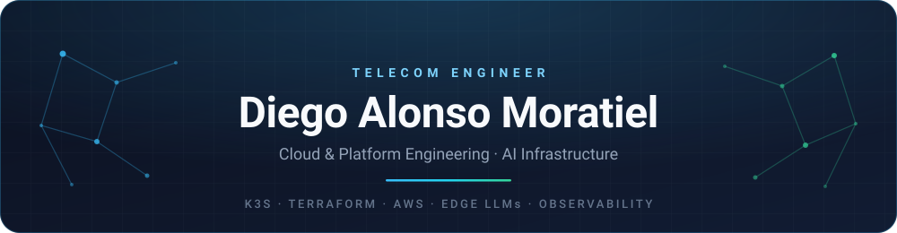

  

 

---

### Hey, I'm Diego 👋

Telecom engineer based in **Valladolid, Spain**, focused on **cloud & platform engineering** and **AI infrastructure**. I like owning a system end to end — from the network and the OS up to the Kubernetes manifests, the dashboards and the automation that keeps it alive.

Most of what I build starts with a small, cheap piece of hardware and a question like *"can this run a real workload?"* — a Raspberry Pi serving an LLM, an edge node feeding a telemetry pipeline, a headless box running an agent unattended. The answer usually ends up as a repo here.

- 🔭 Currently building **edge AI infrastructure** and **agentic automation** on k3s and Raspberry Pis
- 🌱 Going deeper into **Terraform**, **Kubernetes**, **LLM serving** and **observability**
- 🎯 Open to **Cloud / Platform / DevOps / AI-infrastructure** roles in **DACH**
- 💬 Happy to talk about k3s on mixed architectures, llama.cpp, Prometheus or Tailscale

---

### Featured projects

| Project | What it is | Stack |
| :--- | :--- | :--- |
| **[edge-llm-k3s-observability](https://github.com/diego-alonmoratiel/edge-llm-k3s-observability)** | Two-node k3s cluster (PC control plane + Raspberry Pi 5 worker) serving a quantized LLM behind an OpenAI-compatible API, provisioned with Ansible and observed with Prometheus + Grafana over a Tailscale mesh. | `k3s` `llama.cpp` `Ansible` `Prometheus` `Grafana` `Tailscale` |
| **[device-management-api](https://github.com/diego-alonmoratiel/device-management-api)** | Async REST API for registering and monitoring infrastructure devices, containerized and shipped to Kubernetes with Helm. | `FastAPI` `SQLAlchemy` `Docker` `Kubernetes` `Helm` `GitLab CI` |
| **[job-search-automation-harness](https://github.com/diego-alonmoratiel/job-search-automation-harness)** | Dependency-light agentic workflow that runs unattended on a Raspberry Pi, reports over Telegram, and never submits an application without explicit human approval. | `Python` `Playwright` `Telegram API` `Raspberry Pi` |
| **[monitor_xrootd](https://github.com/diego-alonmoratiel/monitor_xrootd)** | Distributed telemetry pipeline that tracks XRootD data transfers across a workstation and an edge node, with metrics scraped into Prometheus and charted in Grafana. | `Flask` `XRootD` `Docker` `Prometheus` `Grafana` |
| **[Cloud Resume Challenge](https://github.com/diego-alonmoratiel/crc-frontend)** ([backend](https://github.com/diego-alonmoratiel/crc-backend)) | Résumé site hosted on AWS with a serverless visitor counter, plus S3 static hosting experiments. | `AWS` `S3` `Lambda` `DynamoDB` `API Gateway` |

---

### Toolbox

**Cloud & infrastructure**

**Observability & networking**

**Languages & backend**

**Automation & delivery**

---

### GitHub, in numbers

---

**Let's build something reliable.**

I'm open to Cloud / Platform / DevOps / AI-infrastructure roles across DACH — happy to talk in English or Spanish.

Valladolid, Spain · CET / CEST

